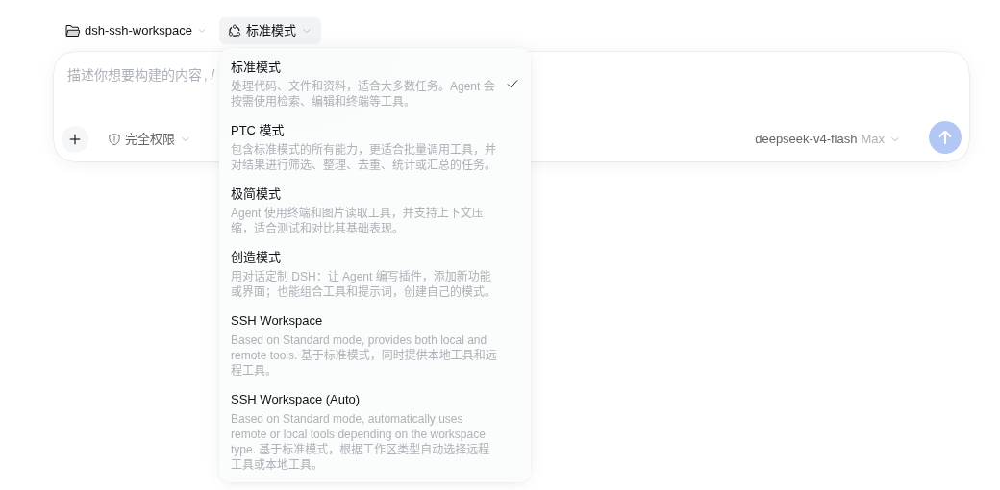

# dsh-ssh-workspace

English | [简体中文](./README.md)

A remote workspace plugin for DeepSeek Harness: in the Web UI, first pick a machine (local or a host
from `~/.ssh/config`), then pick a directory. The workspace file browser, terminal panel/tools, and
`remote_*` tools run on the remote host; the model's ordinary `read`/`write`/`edit`/`bash`/`grep`/
`glob` tools always run on the harness machine with `localCwd` (`/tmp` by default) as their cwd.
A remote workspace requires a preset that enables `remote_*`; otherwise conversation is blocked.

SSH is only a data pipe. A long-running `workspace daemon` lives on the remote side, so a client
disconnect does not interrupt remote commands; after reconnecting, output and final state are
resumed by offset, and writes go through an opId idempotency gate so side effects are never replayed.

## Model-facing tools (preset-gated)

The `remote_*` aliases are **not registered by default**. Installing the bundle injects two agent
presets into the profile:

- **SSH Workspace** (id `ssh-workspace`): registers `remote_read`, `remote_write`, `remote_edit`,
  `remote_read_image` (when attachments are available), `remote_bash`, `remote_grep`, and
  `remote_glob` while keeping the local tools of the same name; the local tools stay on the harness
  machine and only `remote_*` runs on the host.
- **SSH Workspace (Auto)** (id `ssh-workspace-auto`): automatically selects local or remote tools
  based on the workspace type — local workspaces use the local tools; adopted remote workspaces hide
  the local `read`/`write`/`edit`/`read_image`/`bash`/`grep`/`glob` tools so only `remote_*` reaches
  the model, and inject the "this project is remote" system prompt. If hiding cannot be installed
  for the current host, it degrades safely to `both`.



Presets take effect when a session is created or its preset changes; ordinary local sessions and
sessions without one of these presets never see `remote_*`. These tools reuse the official
arguments, approvals, output rendering, and timeouts. File-tool paths and `remote_bash`'s `workdir`
must stay inside the current remote workspace; relative paths resolve from the current remote
directory.

The execution boundary is independent of the preset: ordinary file, `bash`, `grep`, and `glob`
tools always run on the harness machine with `/tmp` (`localCwd`) as their default cwd, while
`remote_*`, the terminal panel/`terminal_*`, and the workspace file UI always run on the host.
Inside a remote workspace, only presets that enable `remote_*` may converse; Standard and any other
unconfigured preset disable input and show a warning. If the session already started and its preset
is locked, create a new session with an SSH Workspace preset.

`remote_grep`/`remote_glob` use the ripgrep binary shipped in the daemon archive. If the host lacks
a binary for its architecture, the call fails with
`remote host '<host>' has no bundled ripgrep; use remote_bash with grep/find or reinstall the daemon`.

## Requirements

| Location | Requirement |
| --- | --- |
| Host | Node ≥ 20; `dsh` 0.2.1-rc.2; a working OpenSSH client; a readable `~/.ssh/config` |
| Remote | Linux x64/arm64; Node ≥ 20; POSIX `sh`; `tar`; an OpenSSH server |
| Authentication | **Non-interactive** login via key or ssh-agent; interactive password auth is not supported |
| SSH | OpenSSH ≥ 8.2 (the client must support `ControlMaster` / `-O forward`) |
| Terminal | The archive ships node-pty for linux-x64; on other platforms/architectures without node-pty only the terminal is unavailable, files and commands still work |
| Search | The archive ships ripgrep for linux-x64/arm64; without it `remote_grep`/`remote_glob` fail while `remote_bash` still works |

## Installation

### From Git (recommended)

```bash
dsh plugin --profile web add https://github.com/ya-b/dsh-ssh-workspace
```

This command will:

1. install `@dsh-ssh-workspace/bundle` into the `web` profile;
2. append the bundle to the profile's `dsh.profile.bundles`;
3. load the three entries `ssh-workspace-mount`, `api-ssh-workspace`, and `ui-ssh-workspace`
   according to the package's `cordis.patch.yml`, plus `presets/ssh-workspace.patch.yml` for the
   two agent presets.

The repository already commits the build artifacts `lib/` and `dist/daemon.tar.gz`, so installing
from Git does **not** require an extra build.

Restart the instance after installation.

### Local development install

```bash
pnpm install
pnpm run build
dsh plugin --profile web add 'link:/abs/path/to/dsh-ssh-workspace'
```

A `link:` install uses `lib/` and `dist/` directly from the checkout. After modifying source, run
`pnpm run build` again and restart the instance; changing source without rebuilding has no effect.

## Configuration

### SSH hosts

The machine list comes from the local machine plus every concrete `Host` alias in `~/.ssh/config`
(following `Include` recursively; wildcard and negation patterns are skipped because they are not
concrete machines). Standard OpenSSH configuration applies: `HostName`, `Port`, `User`,
`IdentityFile`, `ProxyJump`, `ProxyCommand`, and so on.

```sshconfig
# ~/.ssh/config
Host devbox
  HostName 192.0.2.10
  User root
  Port 22
  IdentityFile ~/.ssh/id_ed25519

Include ~/.ssh/config.d/*
```

`ssh devbox true` must succeed without prompting for a password (key, agent, or ControlMaster).
After editing `~/.ssh/config`, refresh the browser page to re-enumerate the host list.

To hide aliases from the picker, use `hiddenHosts` of `api-ssh-workspace`:

```yaml
# ~/.dsh/profiles/web/cordis.patch.yml
- id: api-ssh-workspace
  config:
    hiddenHosts:
      - automation
      - ci-runner
```

### Plugin options

Options for `ssh-workspace-mount`:

| Option | Default | Description |
| --- | --- | --- |
| `daemonDir` | `~/.dsh-workspace` | **Remote** daemon state directory; `~` is expanded by the remote shell |
| `node` | `node` | **Remote** Node executable; the PATH of a non-interactive SSH session often cannot find nvm's Node, so an absolute path such as `/usr/local/bin/node` is recommended |
| `install` | `true` | Deliver the built-in daemon archive the first time a host is used; deduplicated by (host, daemonDir, archive digest) |
| `autoUpgrade` | `true` | On connect, if the running daemon's loaded bundle differs from the installed `workspaced.js` digest and it has no child processes, restart it; a busy daemon is kept and retried on the next connection |
| `daemonArchive` | built-in archive | Override the daemon archive path, mainly for development and debugging |
| `requestTimeoutMs` | `30000` | Timeout for management requests such as install, admit, and open |
| `reconnectBaseMs` | `250` | Initial reconnect backoff |
| `reconnectMaxMs` | `15000` | Maximum reconnect backoff |
| `controlDir` | temporary directory | Local SSH ControlMaster socket directory; defaults to `/tmp/dsh-ws-*` |
| `statePath` | `${DSH_HOME:-~/.dsh}/storages/ssh-workspaces.json` | Local workspace ownership side-mapping path |
| `localCwd` | `/tmp` | Default cwd of ordinary local tools inside a remote workspace; must be absolute. Does not affect the terminal panel or `remote_*` |
| `toolPresets` | `[]` | Agent presets allowed to enable `remote_*`, as `{ id, mode: 'both' \| 'auto' }`; the bundle injects `ssh-workspace` (both) and `ssh-workspace-auto` (auto). Restating the whole `config` row must include this field, otherwise no `remote_*` tools are enabled |

Options for `api-ssh-workspace`:

| Option | Default | Description |
| --- | --- | --- |
| `probeTimeoutMs` | `8000` | Per-attempt timeout for the host connectivity precheck |
| `hiddenHosts` | `[]` | SSH aliases not shown in the machine list |
| `prefix` | `/ssh-workspace` | HTTP route prefix; the browser half hardcodes `/ssh-workspace`, **do not change** |

`ui-ssh-workspace` has no options.

To override options, restate the entire row with the same `id` in the profile's own
`cordis.patch.yml`:

```yaml
# ~/.dsh/profiles/web/cordis.patch.yml
- id: ssh-workspace-mount
  config:
    daemonDir: '~/.dsh-workspace'
    node: /usr/local/bin/node
    install: true
    requestTimeoutMs: 30000
    reconnectBaseMs: 250
    reconnectMaxMs: 15000
    localCwd: /tmp
    toolPresets:
      - id: ssh-workspace
        mode: both
      - id: ssh-workspace-auto
        mode: auto
```

The `config` for the same `id` replaces the bundle's config wholesale; unspecified fields use schema
defaults, so it is best to write all needed fields. If the profile's patch file is still an empty
array `[]`, replace it with the entry rather than appending after `[]`.

### Remote daemon

The first time a directory is opened on a given (host, `daemonDir`), the plugin extracts the
archive over SSH into the remote `daemonDir` and runs the remote Node version check. After that:

- daemon state lives in remote `~/.dsh-workspace`: `sock`, `pid`, `lock`, `running.digest`,
  `config.json`, `streams/`, `daemon.log`, and per-architecture `bin/rg-linux-<arch>`;
- `roots` in `config.json` is the whitelist of directories allowed to be opened as workspaces,
  written by the client before opening, keeping the most recent 64 entries;
- a running daemon is not started twice; client disconnects, heartbeats, or lease changes never
  reap remote processes;
- the daemon writes its own bundle digest to `running.digest` at boot; when a connection finds it
  different from the installed `workspaced.js` and no child process is running, the bootstrap
  gracefully restarts the daemon on the new code (disable with `autoUpgrade: false`); daemons
  from before this file existed are upgraded on their first connect;
- missing or too-old remote Node reports
  `remote workspace daemon preflight failed: <node> is not a usable Node >= 20` during connection
  setup.

## Usage

1. Open the Web UI and go to the sidebar "Add workspace (+)" → "Add workspace…".
2. In the **Host** dropdown at the top of the dialog, select local or an SSH host.
3. Choose a directory (use "Up" to navigate, toggle hidden files), then click "Open".
4. The remote workspace is named `<directory>@<host alias>` by default; the workspace file browser,
   terminal, and `remote_*` tools run on the remote host, while ordinary model tools run locally
   under `localCwd`.
5. Remote workspaces must use **SSH Workspace** or **SSH Workspace (Auto)** in the session's preset
   selector; Auto selects local or remote tools automatically based on the workspace type. Other
   presets show a warning and disable input.

## Upgrade and uninstall

Upgrade the bundle:

```bash
dsh plugin --profile web update @dsh-ssh-workspace/bundle
# or reinstall and pin a commit
dsh plugin --profile web add 'https://github.com/ya-b/dsh-ssh-workspace#<sha>'
```

The new code takes effect after restarting the dsh instance. A daemon already running on the remote
side switches code automatically: the next connection re-delivers the archive, sees that the running
digest differs, and restarts the daemon if it has no child processes — a busy daemon is left alone
and upgraded by a later connection. To force it manually:

```bash
ssh <host> 'kill "$(cat ~/.dsh-workspace/pid)" 2>/dev/null || true'
```

Uninstall:

```bash
dsh plugin --profile web remove @dsh-ssh-workspace/bundle
```

Uninstall only removes the dependency, the bundle selection, and the three patch lines it
contributed; it does not delete the local side mapping or the remote `~/.dsh-workspace`. For a full
cleanup, stop the remote daemon first, then delete the data:

```bash
rm -f "${DSH_HOME:-$HOME/.dsh}/storages/ssh-workspaces.json"
ssh <host> 'kill "$(cat ~/.dsh-workspace/pid)" 2>/dev/null || true; rm -rf ~/.dsh-workspace'
```

## Troubleshooting

| Symptom | What to do |
| --- | --- |
| No remote hosts in the picker | Make sure it is a concrete `Host` alias rather than a wildcard; refresh the page; check `~/.ssh/config` and `Include` |
| Precheck shows `needs-credentials` | `ssh <alias> true` must succeed non-interactively; configure a key or start an agent |
| Node version/path error | Set `node` to an absolute remote path, e.g. `/usr/local/bin/node`; verify `node -v` ≥ 20 |
| Terminal won't open, but files and commands work | The remote platform/architecture does not match the node-pty in the archive; files and commands are unaffected |
| Menu does not appear after installation | Run `dsh --profile web --dump-config` to check the three patch lines; restart the dsh instance |
| Behavior is still old after upgrading | Restart the dsh instance; the remote daemon must also be restarted to load the new archive |

## Development

```bash
pnpm install
pnpm run build        # → lib/{mount,api,index,client}.js + dist/daemon.tar.gz

node tests/api/machines.test.mjs
node tests/daemon/probe-transport.mjs
node tests/daemon/probe-providers.mjs
node tests/daemon/probe-mount.mjs
node tests/daemon/probe-resilience.mjs
```

`lib/` and `dist/daemon.tar.gz` are committed artifacts used by Git installs: after changing source
you must rebuild and commit them. For more on builds, rollback, and operations, see
[`INSTALL.md`](./INSTALL.md); for the implementation plan and evidence ledger, see
[`PLAN.md`](./PLAN.md) and [`PROGRESS.md`](./PROGRESS.md).
